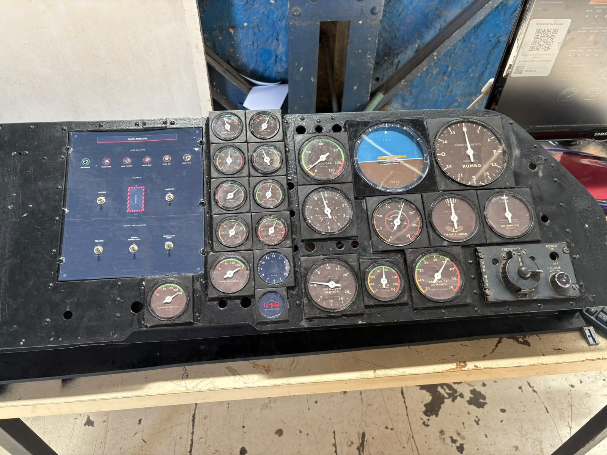
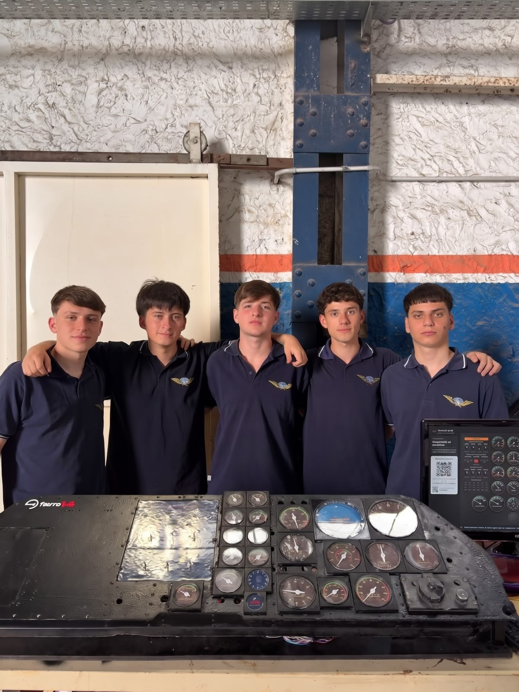

# H-08

Reacondicionamiento aviónico del Sikorsky S-55 de la escuela. Proyecto de 7.º 1.ª, Aviónica, comisión B, de la E.E.S.T. N° 7 "IMPA" (Taller Regional Quilmes), 2026.

- Página: [proyecto-h08.github.io](https://proyecto-h08.github.io/)
- Instagram: [@proyectoh08](https://www.instagram.com/proyectoh08/)
- Mail: h08proyecto2026@gmail.com
- Video de presentación: [YouTube](https://www.youtube.com/watch?v=HCQF5zqOE_o)



## Qué es

H-08 es la matrícula de un Sikorsky S-55 (H-19A) que está en el taller de la escuela. Casi todos los instrumentos originales ya no funcionan, así que armamos el tablero de nuevo para usarlo en clase. Sobre la chapa original van 21 instrumentos con piezas que imprimimos en 3D, y las agujas las mueven servos SG90. La brújula usa un motor paso a paso y hay seis luces de alerta.

Todo lo maneja una Raspberry Pi 5. Tiene un modelo simple del helicóptero (motor, rotor, transmisión, aceite, combustible, parte eléctrica y actitud) y con eso calcula qué tiene que marcar cada instrumento. El profesor elige la fase del vuelo y mete fallas desde el celular, por ejemplo una falla de generador o de bomba de aceite, y los alumnos ven cómo responde cada aguja en el tablero y en su celular.

La Raspberry arma su propia red wifi, así que no hace falta internet:

- red: Tablero-H08
- clave: sikorsky55
- dirección: http://10.55.0.1 (en la mayoría de los celulares se abre sola al conectarse)

## Cómo está armado

La Raspberry habla por I2C con dos placas PCA9685 (direcciones 0x40 y 0x41) que generan el pulso de los 20 servos y prenden las luces. El motor de la brújula es un 28BYJ-48 con su driver ULN2003, conectado a los GPIO 12, 16, 20 y 21. La llave BATERÍA del panel va al GPIO 26 y sirve para apagar todo en orden. Los servos se alimentan aparte, nunca desde la Pi: una fuente de 12 V alimenta un regulador LM2596 que baja a 5 V.

Las conexiones pasan por una placa madre que diseñamos en KiCad (170 x 110 mm, una sola cara).

En los instrumentos donde la aguja tiene que dar más vuelta que lo que gira un servo usamos engranajes impresos: 36/24, 40/24 y 48/24. El horizonte artificial muestra solo el alabeo: el plato va pegado al servo. La brújula gira sin fin con el paso a paso.

La pantalla HDMI de la Raspberry muestra el tablero completo, con las mismas carátulas que pegamos en los instrumentos y un helicóptero en 3D que vuela con la simulación.

## Carpetas

- [Docs](Docs/): carpeta técnica, carpeta de campo, manual de usuario, elementos de alcance inconclusos, anteproyecto e historias de usuario.
- [Kicad](Kicad/): el proyecto de la placa madre y los planos para hacerla.
- [Software](Software/): el programa de la Raspberry Pi 5.
- [Estructura](Estructura/): las piezas para imprimir (STL), las carátulas y cómo se arma cada instrumento.
- [Web](Web/): la página del proyecto.
- [Multimedia](Multimedia/): video de presentación, las diapositivas de la expo, fotos (la del equipo también), logos, banner y stickers.

## Lo que usamos

| Componente | Cant. |
|---|---|
| Raspberry Pi 5 de 4 GB con fuente oficial de 27 W | 1 |
| MicroSD de 16 GB | 1 |
| PCA9685 | 2 |
| Servo SG90 | 20 |
| Motor 28BYJ-48 con driver ULN2003 | 1 |
| LED 5 mm (ámbar, rojo y verde) | 6 |
| Fuente de 12 V 7 A | 1 |
| Regulador LM2596 (de 12 V a 5 V) | 1 |
| Llave de palanca (BATERÍA) | 1 |
| Pantalla HDMI | 1 |
| Placa madre | 1 |

Más las piezas impresas en PLA, los acrílicos de cada instrumento y los pegamentos. La lista completa con precios está en [Docs/Plantilla_de_compras_H08.xlsx](Docs/Plantilla_de_compras_H08.xlsx).

## Para ponerlo en marcha

Primero se imprimen y arman los instrumentos con las piezas de Estructura, y se hace la placa con los planos de Kicad/Planos.

Después se copia `Software/H08_Pi5` a la Raspberry, que tiene que tener Raspberry Pi OS con escritorio de 64 bits, y se instala:

```bash
cd ~/H08_Pi5/raspberry_pi5
bash instalar.sh
sudo reboot
```

Con `python3 diagnostico_pi.py` se revisan las conexiones y con `python3 calibrar_instrumento.py --todos` se calibran las agujas una por una. Todo eso está explicado más largo en [Software/H08_Pi5/LEEME.md](Software/H08_Pi5/LEEME.md) y en el manual de usuario.

## Equipo



- Mateo Ghirelli: software (programa en Python, WiFi y simulación)
- Fausto Taranto: hardware (circuito, calibración y cableado)
- Constantino da Costa: integración, pruebas, redes y presentación
- Thomas Lehmann: restauración mecánica y montaje
- Agustín Merodo: relevamiento, montaje y documentación
